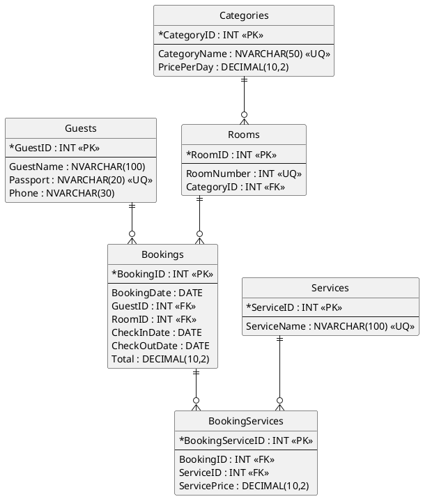

# ПМ.11 — вариант 4. Полное решение

> Основано на файле `var4_pm11.xlsx`.
>
> Предметная область: бронирование гостиницы.
>
> Важно: в исходных данных стоимость одной и той же услуги может отличаться. Например, услуга «Завтрак» встречается с разной стоимостью. Поэтому стоимость услуги хранится не в `Services`, а в связующей таблице `BookingServices`.

---

# Задание 1

## 1. Анализ исходных данных

В исходном файле есть поля:

```text
Nomer_broni
Data_broni
Gost
Pasport
Telefon
Nomer_komnaty
Kategoriya
Cena_za_sutki
Data_zaezda
Data_vyezda
Usluga
Stoimost_uslugi
Itogo
```

В одной строке одновременно хранятся данные о:

- госте;
- номере;
- категории номера;
- бронировании;
- услуге.

Одна бронь может повторяться несколько раз, если в ней несколько услуг.

Выделяем сущности:

```text
Guests
Categories
Rooms
Bookings
Services
BookingServices
```

Связи:

```text
Categories 1:N Rooms
Guests 1:N Bookings
Rooms 1:N Bookings
Bookings 1:N BookingServices
Services 1:N BookingServices
```

Фактически между `Bookings` и `Services` связь `N:M`, реализованная через `BookingServices`.

---

## 2. Обоснование 3НФ

Текст для отчёта:

> Исходный файл содержал ненормализованные данные: сведения о гостях, номерах, категориях, бронированиях и услугах повторялись в нескольких строках. Для устранения избыточности данные были разделены на сущности Guests, Categories, Rooms, Bookings и Services. Связь многие-ко-многим между бронированиями и услугами реализована через таблицу BookingServices. Стоимость услуги хранится в BookingServices, поскольку в исходных данных стоимость одной и той же услуги может различаться. В полученной структуре каждый неключевой атрибут зависит от первичного ключа своей таблицы, что соответствует третьей нормальной форме.

---

## 3. ER-диаграмма PlantUML



---

## 4. Создание таблиц

Сначала выберите нужную базу:

```sql
USE [ИМЯ_ВАШЕЙ_БАЗЫ];
GO
```

Создание таблиц:

```sql
DROP TABLE IF EXISTS dbo.BookingServices;
DROP TABLE IF EXISTS dbo.Bookings;
DROP TABLE IF EXISTS dbo.Services;
DROP TABLE IF EXISTS dbo.Rooms;
DROP TABLE IF EXISTS dbo.Guests;
DROP TABLE IF EXISTS dbo.Categories;
GO

CREATE TABLE dbo.Guests
(
    GuestID INT IDENTITY(1,1) PRIMARY KEY,
    GuestName NVARCHAR(100) NOT NULL,
    Passport NVARCHAR(20) NOT NULL UNIQUE,
    Phone NVARCHAR(30) NOT NULL
);

CREATE TABLE dbo.Categories
(
    CategoryID INT IDENTITY(1,1) PRIMARY KEY,
    CategoryName NVARCHAR(50) NOT NULL UNIQUE,
    PricePerDay DECIMAL(10,2) NOT NULL CHECK (PricePerDay > 0)
);

CREATE TABLE dbo.Rooms
(
    RoomID INT IDENTITY(1,1) PRIMARY KEY,
    RoomNumber INT NOT NULL UNIQUE,
    CategoryID INT NOT NULL
        REFERENCES dbo.Categories(CategoryID)
);

CREATE TABLE dbo.Services
(
    ServiceID INT IDENTITY(1,1) PRIMARY KEY,
    ServiceName NVARCHAR(100) NOT NULL UNIQUE
);

CREATE TABLE dbo.Bookings
(
    BookingID INT PRIMARY KEY,
    BookingDate DATE NOT NULL,
    GuestID INT NOT NULL
        REFERENCES dbo.Guests(GuestID),
    RoomID INT NOT NULL
        REFERENCES dbo.Rooms(RoomID),
    CheckInDate DATE NOT NULL,
    CheckOutDate DATE NOT NULL,
    Total DECIMAL(10,2) NOT NULL CHECK (Total >= 0),
    CHECK (CheckOutDate > CheckInDate)
);

CREATE TABLE dbo.BookingServices
(
    BookingServiceID INT IDENTITY(1,1) PRIMARY KEY,
    BookingID INT NOT NULL
        REFERENCES dbo.Bookings(BookingID),
    ServiceID INT NOT NULL
        REFERENCES dbo.Services(ServiceID),
    ServicePrice DECIMAL(10,2) NOT NULL CHECK (ServicePrice >= 0),
    UNIQUE (BookingID, ServiceID)
);
GO
```

Проверка:

```sql
SELECT TABLE_NAME
FROM INFORMATION_SCHEMA.TABLES
WHERE TABLE_TYPE = 'BASE TABLE';
```

---

## 5. Импорт исходного файла

### 5.1. Подготовка файла

Откройте `var4_pm11.xlsx` в Excel:

```text
Файл → Сохранить как → CSV UTF-8
```

В SSMS:

```text
ПКМ по базе
→ Задачи
→ Импортировать неструктурированный файл
```

Имя новой таблицы:

```text
RawImport
```

Для максимально надёжного импорта все столбцы можно оставить как `NVARCHAR`.

После импорта:

```sql
SELECT * FROM dbo.RawImport;
```

В исходном варианте должно быть 11 строк.

### 5.2. Перенос в нормализованные таблицы

Запустить весь блок:

```sql
INSERT INTO dbo.Guests(GuestName, Passport, Phone)
SELECT DISTINCT
    Gost,
    Pasport,
    Telefon
FROM dbo.RawImport;


INSERT INTO dbo.Categories(CategoryName, PricePerDay)
SELECT DISTINCT
    Kategoriya,
    TRY_CONVERT(DECIMAL(10,2), Cena_za_sutki)
FROM dbo.RawImport;


INSERT INTO dbo.Rooms(RoomNumber, CategoryID)
SELECT DISTINCT
    TRY_CONVERT(INT, r.Nomer_komnaty),
    c.CategoryID
FROM dbo.RawImport r
JOIN dbo.Categories c
    ON c.CategoryName = r.Kategoriya;


INSERT INTO dbo.Services(ServiceName)
SELECT DISTINCT
    Usluga
FROM dbo.RawImport;


INSERT INTO dbo.Bookings
(
    BookingID,
    BookingDate,
    GuestID,
    RoomID,
    CheckInDate,
    CheckOutDate,
    Total
)
SELECT DISTINCT
    TRY_CONVERT(INT, r.Nomer_broni),
    TRY_CONVERT(DATE, r.Data_broni),
    g.GuestID,
    rm.RoomID,
    TRY_CONVERT(DATE, r.Data_zaezda),
    TRY_CONVERT(DATE, r.Data_vyezda),
    TRY_CONVERT(DECIMAL(10,2), r.Itogo)
FROM dbo.RawImport r
JOIN dbo.Guests g
    ON g.Passport = r.Pasport
JOIN dbo.Rooms rm
    ON rm.RoomNumber = TRY_CONVERT(INT, r.Nomer_komnaty);


INSERT INTO dbo.BookingServices
(
    BookingID,
    ServiceID,
    ServicePrice
)
SELECT DISTINCT
    TRY_CONVERT(INT, r.Nomer_broni),
    s.ServiceID,
    TRY_CONVERT(DECIMAL(10,2), r.Stoimost_uslugi)
FROM dbo.RawImport r
JOIN dbo.Services s
    ON s.ServiceName = r.Usluga;
GO
```

Проверка всех таблиц:

```sql
SELECT * FROM dbo.Guests;
SELECT * FROM dbo.Categories;
SELECT * FROM dbo.Rooms;
SELECT * FROM dbo.Services;
SELECT * FROM dbo.Bookings;
SELECT * FROM dbo.BookingServices;
```

Контрольный запрос:

```sql
SELECT
    b.BookingID,
    g.GuestName,
    r.RoomNumber,
    c.CategoryName,
    s.ServiceName,
    bs.ServicePrice,
    b.CheckInDate,
    b.CheckOutDate,
    b.Total
FROM dbo.BookingServices bs
JOIN dbo.Bookings b ON b.BookingID = bs.BookingID
JOIN dbo.Guests g ON g.GuestID = b.GuestID
JOIN dbo.Rooms r ON r.RoomID = b.RoomID
JOIN dbo.Categories c ON c.CategoryID = r.CategoryID
JOIN dbo.Services s ON s.ServiceID = bs.ServiceID
ORDER BY b.BookingID;
```

Текст для отчёта:

> Исходный файл был импортирован во временную таблицу RawImport. После этого данные были очищены от повторов и перенесены в нормализованные таблицы с использованием SELECT DISTINCT и JOIN.

---

# Задание 2

## 1. Три обязательных SELECT-запроса

### Запрос 1 — JOIN минимум трёх таблиц

```sql
SELECT
    b.BookingID,
    g.GuestName,
    r.RoomNumber,
    c.CategoryName,
    s.ServiceName,
    bs.ServicePrice,
    b.Total
FROM dbo.BookingServices bs
JOIN dbo.Bookings b ON b.BookingID = bs.BookingID
JOIN dbo.Guests g ON g.GuestID = b.GuestID
JOIN dbo.Rooms r ON r.RoomID = b.RoomID
JOIN dbo.Categories c ON c.CategoryID = r.CategoryID
JOIN dbo.Services s ON s.ServiceID = bs.ServiceID
ORDER BY b.BookingID;
```

Пояснение:

> Запрос объединяет данные о бронированиях, гостях, номерах, категориях и дополнительных услугах.

### Запрос 2 — GROUP BY + HAVING

```sql
SELECT
    c.CategoryName,
    COUNT(b.BookingID) AS BookingCount
FROM dbo.Bookings b
JOIN dbo.Rooms r ON r.RoomID = b.RoomID
JOIN dbo.Categories c ON c.CategoryID = r.CategoryID
GROUP BY c.CategoryName
HAVING COUNT(b.BookingID) > 1;
```

Пояснение:

> Запрос выводит категории номеров, для которых оформлено более одного бронирования.

### Запрос 3 — подзапрос

```sql
SELECT
    BookingID,
    Total
FROM dbo.Bookings
WHERE Total >
(
    SELECT AVG(Total)
    FROM dbo.Bookings
);
```

Пояснение:

> Запрос выводит бронирования, итоговая стоимость которых выше средней стоимости всех бронирований.

---

## 2. Экспорт двух SELECT в CSV

Для первого и второго запроса:

```text
Выполнить запрос
→ ПКМ по таблице результата
→ Сохранить результаты как...
→ CSV
```

Например:

```text
query1.csv
query2.csv
```

Для отчёта сделать скрин результатов и файлов CSV.

---

## 3. Резервное копирование и восстановление

### 3.1. Полная резервная копия

Через SSMS:

```text
ПКМ по базе
→ Задачи
→ Резервное копирование
→ Тип: Полная
```

Сохранить, например:

```text
hotel_full.bak
```

### 3.2. Изменить минимум 3–5 записей

```sql
UPDATE dbo.Categories
SET PricePerDay = PricePerDay + 100
WHERE CategoryID IN (1, 2, 3);

UPDATE dbo.Guests
SET Phone = N'7-999-000-00-00'
WHERE GuestID = 1;

UPDATE dbo.Bookings
SET Total = Total + 500
WHERE BookingID = 4001;
```

Здесь изменено 5 записей:
- 3 категории;
- 1 гость;
- 1 бронирование.

### 3.3. Разностная резервная копия

```text
ПКМ по базе
→ Задачи
→ Резервное копирование
→ Тип: Разностная
```

Сохранить:

```text
hotel_diff.bak
```

### 3.4. Смоделировать потерю данных

```sql
DELETE FROM dbo.BookingServices;

SELECT * FROM dbo.BookingServices;
```

Таблица должна стать пустой.

### 3.5. Восстановление

Сначала восстановить `hotel_full.bak` с режимом:

```text
NORECOVERY
```

Затем восстановить `hotel_diff.bak` с режимом:

```text
RECOVERY
```

После восстановления проверить:

```sql
SELECT * FROM dbo.BookingServices;
SELECT * FROM dbo.Categories;
SELECT * FROM dbo.Guests;
SELECT * FROM dbo.Bookings;
```

Текст для отчёта:

> Была создана полная резервная копия базы данных. После внесения изменений была создана разностная резервная копия. Для моделирования потери данных содержимое таблицы BookingServices было удалено. База данных была восстановлена сначала из полной, затем из разностной резервной копии. После восстановления данные присутствуют и внесённые до разностного копирования изменения сохранены.

---

## 4. Триггер

Для варианта удобно сделать аудит изменения итоговой стоимости бронирования.

### Таблица аудита

```sql
CREATE TABLE dbo.BookingTotalAudit
(
    AuditID INT IDENTITY(1,1) PRIMARY KEY,
    BookingID INT NOT NULL,
    OldTotal DECIMAL(10,2),
    NewTotal DECIMAL(10,2),
    ChangedAt DATETIME2 NOT NULL DEFAULT GETDATE()
);
GO
```

### Триггер

```sql
CREATE TRIGGER dbo.trg_BookingTotalAudit
ON dbo.Bookings
AFTER UPDATE
AS
BEGIN
    INSERT INTO dbo.BookingTotalAudit
    (
        BookingID,
        OldTotal,
        NewTotal
    )
    SELECT
        i.BookingID,
        d.Total,
        i.Total
    FROM inserted i
    JOIN deleted d
        ON d.BookingID = i.BookingID
    WHERE i.Total <> d.Total;
END;
GO
```

### Проверка триггера

```sql
UPDATE dbo.Bookings
SET Total = Total + 100
WHERE BookingID = 4001;

SELECT *
FROM dbo.BookingTotalAudit;
```

Пояснение:

> Триггер автоматически фиксирует изменение итоговой стоимости бронирования. В таблицу BookingTotalAudit записываются номер бронирования, старая стоимость, новая стоимость и время изменения.

---

# Что должно быть в отчёте

## Задание 1

Скриншоты:

1. Исходный файл.
2. ER-диаграмма.
3. Структура созданных таблиц.
4. `RawImport` после импорта.
5. Заполненные нормализованные таблицы.
6. Контрольный JOIN.

Краткий текст:

> Выполнен анализ исходных ненормализованных данных. Выделены сущности и связи, схема приведена к третьей нормальной форме. Созданы таблицы с первичными и внешними ключами и ограничениями целостности. Исходные данные импортированы и распределены между нормализованными таблицами.

## Задание 2

Скриншоты:

1. Запрос с JOIN и результат.
2. GROUP BY + HAVING и результат.
3. Запрос с подзапросом и результат.
4. Два экспортированных CSV-файла.
5. Параметры полной резервной копии.
6. Изменённые записи.
7. Параметры разностной резервной копии.
8. Удалённые данные.
9. Восстановленные данные.
10. Код триггера.
11. Пример срабатывания триггера.

---

# Короткая шпаргалка

## Порядок выполнения задания 1

```text
CSV
↓
RawImport
↓
CREATE TABLE
↓
INSERT SELECT DISTINCT
↓
JOIN для получения FK
↓
проверка SELECT
↓
ER-диаграмма + скриншоты
```

## Порядок выполнения задания 2

```text
3 SELECT
↓
2 CSV
↓
Full backup
↓
изменить 3–5 записей
↓
Differential backup
↓
удалить данные
↓
Full NORECOVERY
↓
Differential RECOVERY
↓
Trigger
↓
отчёт
```

---

# Важные данные именно варианта 4

В исходном файле:

```text
11 строк
7 бронирований
6 гостей
6 номеров
3 категории
4 вида услуг
```

Бронирования:

```text
4001–4007
```

Категории:

```text
Стандарт
Люкс
Полулюкс
```

Услуги:

```text
Завтрак
Трансфер
SPA
Бассейн
```

Стоимость одной и той же услуги может различаться, поэтому `ServicePrice` находится в `BookingServices`, а не в `Services`.
